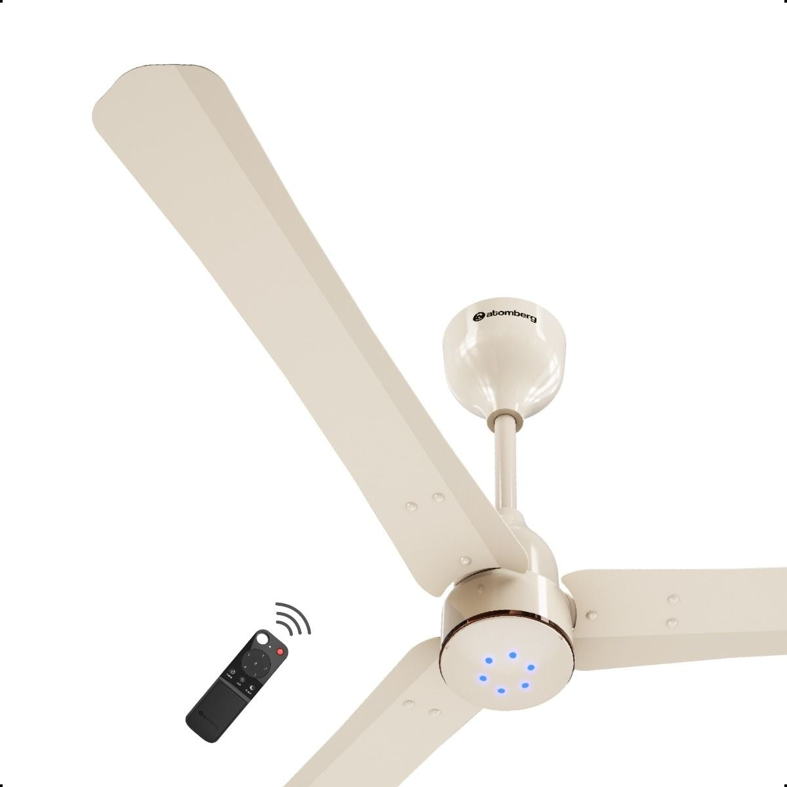

# Atomberg Fan

A tiny macOS menu bar app for an Atomberg smart fan. It uses the public
[Atomberg Home API](https://developer.atomberg-iot.com/reference) and nothing
else — no private endpoints, no reimplemented protocol, no accounts to sign into
beyond the credentials Atomberg already gives you.



*Unofficial. Not affiliated with Atomberg Technologies.*

## Requirements

| | |
| --- | --- |
| macOS | **27 or later** (`LSMinimumSystemVersion` 27.0) |
| Toolchain | Xcode with Swift 6 (built and tested with Swift 6.4 on macOS 27.0.1) |
| Dependencies | None. Foundation, SwiftUI, AppKit and Security only. |

## Build and run

```sh
scripts/build-app.sh --run
```

That regenerates the icons from `assets/fan-asset.jpg`, builds the release
binary, assembles `dist/Atomberg Fan.app` and signs it ad-hoc. The finished
bundle is about 1.8 MB.

Other useful commands:

```sh
swift build -c release     # binary only, no bundle
swift run                  # runs from .build, falling back to ./Resources
scripts/build-app.sh       # bundle without launching
```

Because the app is a menu bar extra (`LSUIElement`), it has no Dock icon and no
application menu. Look for the fan in the menu bar; `Quit` is in the panel's
footer. Right-clicking the item gives the same actions as a menu — Open Control
Panel, Setup… (`⌘,`), Refresh State, Refresh Usage and Quit.

Clicking the fan opens the **control panel**: a card-style window with the fan
on a hero plate, its live state as chips, and one section per group of commands.
**Setup** opens a separate, ordinary window. That separation is deliberate: a
status-bar panel belonging to an accessory app cannot reliably take keyboard
focus, so text fields inside one refuse to be typed into.

## Setting it up

1. Open the **Atomberg Home** app → **Settings → Developer Mode** and turn it on.
   It shows one API key and one refresh token for the account.
2. On first launch the app opens **Setup** by itself. Paste each value into its
   field — the clipboard button fills it for you, and the eye shows what you
   pasted so it can be checked against the Atomberg app — then press **Save &
   connect** (or just `Return`).
3. The app fetches your devices and selects the first fan. Pick a different one
   from the **Fan** picker if the account has several.

Both values are stored in your **login keychain** (`com.openberg.AtombergFan`),
never in a preferences file. `Forget` removes them.

## What it can do

Every control maps to a command in the API reference, and each is shown **only
if the device itself advertises it** in `supported_commands` from
`GET /get_list_of_devices`. A Renesa that does not have a light never shows a
light control, so unsupported series never produce an error 400.

| Control | Command |
| --- | --- |
| Fan on / off | `power` |
| Speed 1–6 | `speed` |
| − / + beside the speed | `speedDelta` |
| Timer: off, 1, 2, 3, 6 hours | `timer` |
| Sleep mode | `sleep` |
| Light | `led` |
| Brightness 10–100 % | `brightness` (steps with `brightnessDelta`) |
| Light colour: warm, cool, daylight | `light_mode` |
| Reverse rotation | `rev_mode` |
| Beep on press | `buzzer_status` |

Reads: `GET /get_device_state` for power, speed, sleep, light, brightness,
colour, reverse, buzzer, `is_online` and the timer; `GET /get_device_analytics`
for lifetime kWh and runtime. The menu bar glyph is dimmed when the fan is off
and dimmer still when it is offline.

Reach for `GET /get_access_token` only when needed — the access token is cached
in the keychain for its full 24 hours, so relaunching the app does not cost a
call.

## The quota is the main constraint

The free plan allows **100 calls a day** at **5 per second**, resets at 00:00
UTC, and **failed calls count**. That shapes the whole app:

* the access token is reused for 24 hours rather than re-minted per request;
* state and analytics are read with `device_id=all`, so six devices cost one
  call rather than six;
* overlapping reads are dropped instead of queued;
* a burst of commands is followed by **one** read-back, not one per command;
* errors 429, 500, 502, 503 and 504 are retried with backoff; every other 4xx
  is not, so a bad request cannot burn the quota in a loop;
* 401 triggers one token refresh and a single retry, per the reference;
* the footer shows `used today` against the 100 limit, and the auto-refresh
  picker shows the daily call cost of each interval before you choose it.

Auto-refresh is **Manual** by default. Reading a fan's state every 15 minutes
costs about 96 calls a day, which is already most of the quota.

## Local network control (opt-in)

The reference documents that fans broadcast a beacon on UDP **5625** once a
second and accept the same command JSON on UDP **5600**, which means a command
sent over the LAN costs **no API call**. Switch on **Control the fan over your
LAN** in Setup to use it; macOS will ask for local network permission once.

When a fan is found, the app sends commands straight to it and the header badge
changes from `Cloud` to `LAN`. Two honest caveats:

* the LAN command path is documented; the matching between a cloud `device_id`
  and a beacon's MAC is inferred (both are 12 hexadecimal characters), so if a
  fan cannot be matched the app silently keeps using the cloud;
* the reference says a fan *broadcasts its state* on the LAN after every change
  but does not specify that packet's format. The app applies it when it parses
  as JSON and otherwise records a short preview of the last packet on port 5600
  under **Setup → Local network** so you can see what your fan actually sends.

The cloud API stays the default and the fallback in every case.

## What it deliberately does not do

* `POST /get_lock_dynamic_pin` — smart locks only, irrelevant to a fan.
* Water purifier commands — the endpoints are the same, the commands are not.
* Anything the reference does not define: no schedules, no scenes, no
  automation rules, no state the API does not return.

## Layout

```
Package.swift                     macOS 27 floor, no dependencies
Info.plist                        LSUIElement, local network usage string
assets/fan-asset.jpg              the only source artwork
Tools/GenerateIcons.swift         derives .icns + menu bar template from it
scripts/build-app.sh              icons → build → bundle → ad-hoc sign
Sources/AtombergFan/
  App/AtombergFanApp.swift        @main, the accessory app delegate
  App/PanelController.swift       status item, key-capable panel, Setup window
  App/AppModel.swift              main-actor state, quota accounting, commands
  API/AtombergAPI.swift           the five endpoints used
  API/Models.swift                lenient decoders for the documented payloads
  LAN/LANLink.swift               optional UDP transport (ports 5625 / 5600)
  Support/Keychain.swift          credentials at rest
  Support/CallBudget.swift        daily call tally
  Support/Assets.swift            resource lookup + template image dimming
  Views/Theme.swift               cards, pills, sliders, the shared look
  Views/ControlPanelView.swift    the card panel: header, hero, controls, footer
  Views/SetupView.swift           credentials, refresh policy, LAN diagnostics
```

`Resources/` is generated and not tracked; `scripts/build-app.sh` recreates it
from `assets/fan-asset.jpg`. That one photograph supplies everything, and the
same subject mask is reused three ways:

* the **menu bar glyph**, as a silhouette (largest blob kept, which drops the
  remote in the source art, edges feathered) shipped as a template image so it
  renders correctly on light and dark menu bars;
* the **hero banner**, where the fan is cut out of its white backdrop and
  composited onto a cream plate and a graphite plate, one per appearance;
* the **app icon**, on a squircle plate.

## Verification performed

* `swift build -c release` — clean, no warnings.
* All five endpoint paths and the `x-api-key` / `Authorization` headers checked
  against the live API: real paths answer `401 Unauthorized`, a wrong path
  answers `403 Missing Authentication Token`, exactly as the reference's status
  table describes.
* Decoders exercised against the OpenAPI document's own example payloads,
  including a device list with a fan, a purifier and a lock, every fan state
  field, sparse state with unreported keys missing, integer-typed booleans and
  `null` analytics counters.
* Confirmed `401` is not auto-retried, so a misconfigured key cannot burn quota.
* Launch, idle stability and resource use measured on macOS 27.0.1.
* Keyboard focus, driven through the real `PanelController` in a bundled
  accessory app: clicking the API key field makes it first responder, and typed
  characters reach the SwiftUI binding. The Setup action was invoked as the
  panel button invokes it and confirmed to put an on-screen, correctly sized
  Setup window up while dismissing the panel.
* The panel and the Setup window rendered offscreen in both appearances and
  inspected, along with every menu bar glyph state.

**Not verified:** controlling a real fan, because that needs a working pair of
credentials and a device on the account. The command bodies, the gate on
`supported_commands` and the read-back after a command are unexercised against
real hardware.
