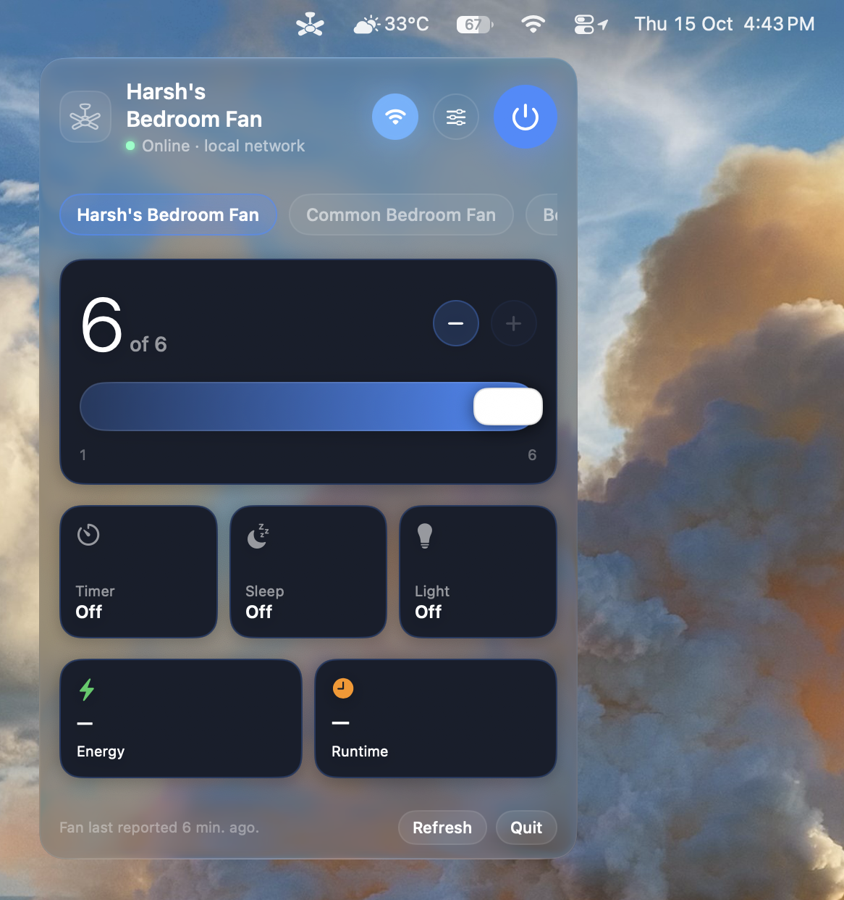
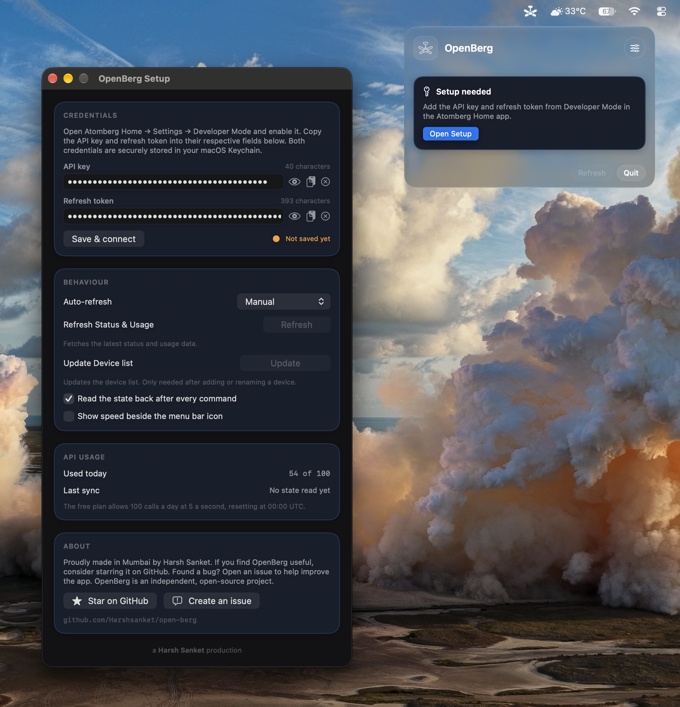

# OpenBerg

A free, open source macOS menu bar app for Atomberg smart fans.



OpenBerg lives in your menu bar. Click the fan icon and a small panel opens with everything your fan supports: power, speed, sleep, timer, light, reverse and buzzer. It also shows lifetime energy and runtime, and whether the fan is being reached over your local network or through the cloud.

## What it offers

* Power on and off, and speed from 1 to 6.
* Sleep mode, timer and buzzer, where your fan supports them.
* Light brightness and colour (warm, cool, daylight) for fans with a light.
* Reverse mode for reversible fans.
* Lifetime energy and runtime, read from Atomberg's own analytics.
* Local network control is on by default whenever the fan is reachable that way, but only after Setup has saved your credentials; the fan is matched by its device id. It is faster and does not use cloud calls, and the app falls back to the cloud on its own.
* A menu bar icon that reflects the fan state, with the current speed beside it if you like.
* Starts at login by default, so the menu bar icon is back after a restart. The switch to turn it off is in Setup.
* Remembers where you left it: the last known state is restored from a local snapshot on every launch, so opening the panel never refetches what it already knows.
* Updates itself: Setup checks GitHub when the app is started and once a month (or on demand), and can install a new version in place. This never touches the Atomberg call quota.
* Credentials stored in the macOS keychain, never in plain files.
* Stays inside the free plan limit of 100 cloud calls a day, with the count shown in Setup. Manual refresh is the default, and the usage totals are read at most once a day on a timer.
* Quiet in the background: OpenBerg listens on the local network and refreshes status only while the panel is open. With the panel closed it stays idle, spending no cloud calls.

Controls for features your fan does not have are simply not shown.

## Requirements

* macOS 27 or later.
* An Atomberg fan with Wi-Fi, on your Atomberg Home account.
* Developer Mode enabled in the Atomberg Home app (Setup walks you through this).

## Setup

1. Open the Atomberg Home app, go to Settings, then Developer Mode, and enable it.
2. Copy the API key and the refresh token shown there.
3. Open OpenBerg. The Setup window opens on first launch. Paste both values and click Save & connect.
4. Pick your fan from the list.



Local network control starts once your credentials are saved: the fan is matched by the device id from your account, so it cannot be found locally before Setup. After that it is on by default, and on first use macOS may ask for Local Network permission. Allow it and OpenBerg prefers the local network; if the fan is not reachable there, it falls back to the cloud automatically. Save & connect itself spends one call to fetch your fan list, then reads the status over the local network; only when the fan does not send its status locally does it spend one more call, for the fan's state. Usage totals are never fetched by Setup — they follow your refresh setting and the Refresh button. OpenBerg also starts at login by default, so the menu bar icon survives a restart. Everything can be changed later from the same Setup window.

## Install

Download from the [Releases page](https://github.com/Harshsanket/open-berg/releases):

* **OpenBerg-1.1.0.dmg**: open it and drag OpenBerg into Applications.
* **OpenBerg-1.1.0.zip**: the app bundle as a zip, if you prefer that.

The app is not notarized by Apple, so the first launch is blocked by macOS. To allow it:

1. Try to open OpenBerg once. macOS refuses.
2. Open System Settings, go to Privacy & Security, scroll to the OpenBerg message and click Open Anyway.
3. Confirm. This is needed once, and the app opens normally after that.

## Notes

* OpenBerg is an independent, open source project. It is not affiliated with Atomberg.
* Thanks to Atomberg for offering Developer Mode, which makes apps like this possible.
* Written in Swift with SwiftUI and AppKit, following Apple's documentation for menu bar apps. No third party dependencies.
* Built with help from DeepSeek.
* Free to use under the MIT License.

## Build from source

```
swift build -c release
scripts/build-app.sh      # app bundle in dist/
scripts/build-release.sh  # app, DMG and zip in dist/
```

---

<p align="center">a <b>Harsh Sanket</b> production</p>
